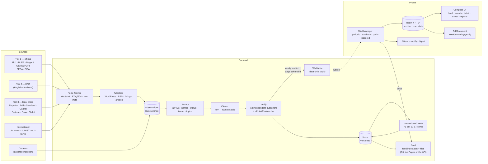

# Architecture

## Overview



The backend does everything that needs many sources at once — crawling,
clustering reports about the same law, counting independent publishers. The
phone keeps a complete local archive and does everything personal — filtering,
notifications, bookmarks, tags, search, reports — so the server never learns what
any user is interested in.

## Backend

| Component | Module | Notes |
|---|---|---|
| Polite fetcher | `sources/http.py` | Checks robots.txt for our user agent before any request (cached 24 h; 5xx/unreachable ⇒ no crawling); honours `Crawl-delay`; per-host lock and delay; conditional GET with stored ETag/Last-Modified; 15 MB response cap. |
| Adapters | `sources/adapters.py` | **WordPress REST** (most Ethiopian newspapers and many agency sites): asks only for posts newer than the stored cursor, fetches titles first and full content only for legal candidates, falls back to RSS. **RSS/Atom** for international feeds. **Official listing harvester**: finds links whose anchor text or table row carries a law identifier or a legal-document word — no brittle CSS selectors — and reads the first pages of linked PDFs (gazette detection). **Article lists** for ENA/HoPR news. |
| Source catalog | `sources/catalog.py` | Tier, publisher (unit of independence), interval, aliases used by other outlets when crediting it. |
| Text | `text/` | Amharic folding (homophones, vowel-order equivalence, Ge'ez numerals, old spellings), Ethiopian calendar, law-ID and law-name extraction, status/issuer/topic classification, shingle similarity. |
| Pipeline | `pipeline/` | Observation → signals → items → verification → summaries → international quota. See VERIFICATION.md. |
| Feed | `static_feed.py`, `api/app.py` | The sync data as plain files (index, snapshot, segments) that any static host can serve; the API serves the same paths. Anonymous. |
| Push | `push.py` | FCM HTTP v1, topic message, data-only, collapse key, high priority only when something can notify. |
| Scheduler | `cli.py run` / `cli.py publish` | On a server, `run` loops every minute: crawl the sources that are due (each has its own interval, 15 min for ENA to 12 h for IGAD), then publish. On GitHub, `.github/workflows/feed.yml` runs `publish` (one cycle + static export) every 30 minutes and deploys to GitHub Pages. |

### Sync protocol (the feed)

Every item write takes the next value of a global counter (`items.version`). The
feed is a set of plain JSON files, so it can be published to any static host
(GitHub Pages, a CDN) or served by the API at the same paths:

```
feed/index.json            {"format": "lexet-feed-1", "epoch": 1333470310, "version": 1840,
                            "snapshot": {"file": "snapshot-1bec61ac8833.json", "count": 412},
                            "segments": [{"k": 18, "from": 1800, "to": 1840, "file": "seg-18-77c0….json", "count": 9}, …]}
feed/snapshot-<hash>.json  every current item          → what a new install downloads (one request)
feed/seg-<k>-<hash>.json   changes with version in (k·100, (k+1)·100], including deletions
feed/sources.json          monitored sources with last success / last error
```

The app keeps the highest version it has. Each sync revalidates the small index;
if its version is not newer, that is the whole sync. Otherwise a new install
fetches the snapshot, and an existing one fetches only the segments that end
after its version — usually one small file. Snapshot and segment names carry a
hash of their content, so a CDN can never pair a fresh index with stale data, and
superseded files are kept for an hour for phones holding an older index. The
`epoch` identifies the dataset: if the server's database is ever rebuilt, phones
see a new epoch, drop their copy and take the snapshot again.

Items carry everything the app shows, including the per-source evidence. Merged
items arrive as tombstones (`{"id": "…", "deleted": true, "merged_into": "…"}`) so the
app can move bookmarks and tags to the surviving item. Each file is applied in one
database transaction and the cursor is saved after it, so an interrupted sync
resumes cheaply. (`GET /v1/sync?since=N`, the earlier paged delta protocol, is still
served by the API.)

### Push design

The server never sends content in push messages and never targets devices. When a
cycle produces a newly verified Ethiopian item, or a verified stage change, it
sends one message to the topic every install subscribes to:

```json
{"message": {"topic": "lexet-et", "data": {"kind": "sync", "v": "1840", "n": "2"},
             "android": {"priority": "high", "collapse_key": "sync", "ttl": "86400s"}}}
```

Each phone syncs the delta and decides locally — against the user's filters —
whether anything deserves a notification. `collapse_key` means a phone that was
offline gets one tickle, not a backlog. Unconfirmed items and edits never trigger
a push; they arrive with the next scheduled sync.

## Android app

| Area | Implementation |
|---|---|
| Storage | Room. `items` (full archive), `item_fts` (FTS4, *simple* tokenizer, text pre-normalised by the domain module), `user_state` (read/bookmark/note), `tags`/`item_tags`, `pending_notices` (digest queue), `reports`. Settings in DataStore. |
| Search | Every word must match, as a prefix. The index stores each token plus its Amharic prefix-stripped form (የመረጃ → መረጃ), law IDs with both the Gregorian and the Ethiopian year (1427/2026 and 1427/2018), and issuer/topic labels in both languages. Homophone spellings fold together on both sides, so ፍትሕ finds ፍትህ. |
| Sync triggers | (1) periodic WorkManager job with a network constraint — every 6 h as a safety net when push is on, or at the user's interval (30 min–6 h) when it is off; (2) push tickle → expedited one-time job; (3) app opened; (4) **connectivity regained**: when the network drops, a one-time job gated on connectivity is queued — JobScheduler starts it the moment the network returns, even if the app process is gone — and while the process is alive a network callback triggers an immediate sync. Failures retry with exponential backoff. |
| Notifications | Only verified Ethiopian items, when first verified or when the verified stage advances. Filters: document type (including "draft bill"), issuing body, topic, keywords (Amharic-aware, whole-word prefix), urgency ("upcoming", "about to be released", "now in force"). Delivery: instant, hourly or daily digest. Three channels by urgency so users can set sound/importance per stage. Lock-screen content on by default with a redacted public version when turned off. "Mark read" and "Bookmark" actions. Nothing notifies during the very first sync. |
| Feed | Ethiopian items newest-activity first, one featured international item after every ten. Unread dot, status and verification badges, law IDs in both calendars. |
| Reports | Built on the device from the local archive (works offline): weekly (Mon–Sun), monthly and yearly, in the Gregorian or the Ethiopian calendar. Sections per document type plus "status changes during the period", numbered citations, cover with totals and the verification rule. PDF via `android.graphics.pdf.PdfDocument` + `StaticLayout` (Amharic shaped with the system Ethiopic font), with a table of contents carrying real page numbers (two-pass layout). Auto-generated daily when a period has ended; viewable in-app with tappable links, exportable, shareable. |
| UI | Jetpack Compose, Material 3, light/dark/system theme, English and Amharic UI resources (per-app language on Android 13+), titles in either language first, dates in Gregorian, Ethiopian or both. |

### Battery and data

- No polling loop: background work is WorkManager jobs with network constraints;
  push wakes the phone only for notifiable changes.
- A sync with nothing new is a single conditional request answered with 304.
- Payloads are gzip-compressed JSON; news sources carry at most a 280-character
  excerpt; official texts up to 20 KB (for full-text search of law text).
- List screens read a lightweight projection, never the source excerpts.
- Optional "background sync on Wi-Fi only".
- No analytics, crash-reporting or advertising SDKs.

### Privacy

No account, no sign-in, no device identifier sent to the backend. Requests carry
only the sync cursor. Filters, bookmarks, tags and notes never leave the phone
(they are included in the user's own Android backup). Push, if enabled, is a
topic subscription through Google Firebase; turning push off unsubscribes and
deletes the token. Permissions: `INTERNET`, `ACCESS_NETWORK_STATE`,
`POST_NOTIFICATIONS` (asked with an explanation), and the foreground-service
permissions WorkManager needs to finish an urgent sync on Android 11 and older.

## Scaling path

The MVP runs as two processes (API + scheduler) on one small server with SQLite
in WAL mode. Growth steps, none of which change the app:

1. PostgreSQL (`LEXET_DATABASE_URL`; replace the `meta` counter with a sequence; add `pg_trgm` for name matching).
2. Serve the feed from a CDN: its files are identical for every phone, and the hashed
   ones never change, which absorbs the burst after a push.
3. Run several scheduler workers, partitioned by source.
4. Move robots/ETag caches to Redis.

## Technology choices

| Choice | Why |
|---|---|
| Python for the backend | Best ecosystem for scraping, PDF text and text processing; the pipeline is I/O-bound. |
| FastAPI + SQLAlchemy 2 | Typed, fast, small; the same models run on SQLite and PostgreSQL. |
| httpx + lxml + feedparser + pypdf | Async HTTP with streaming size limits; tolerant HTML parsing; robust feeds; PDF text without native dependencies. |
| Kotlin, Compose, Material 3 | Current native Android stack; dark mode and dynamic layouts with little code. |
| Room with FTS4 | Offline-first archive with full-text search; FTS4 (not FTS5) because Room supports it directly; normalisation done in Kotlin so behaviour does not depend on the phone's SQLite. |
| WorkManager | The battery-safe way to run background sync, with network constraints, backoff and expedited jobs. |
| OkHttp + kotlinx.serialization | Small and fast; no reflection. |
| Manual dependency wiring | One container class; no DI framework or annotation processing beyond Room. |
| Pure-Kotlin `:domain` module | The rules that must agree with the server (normalisation, calendar, notification rules) are testable on any JVM. |
