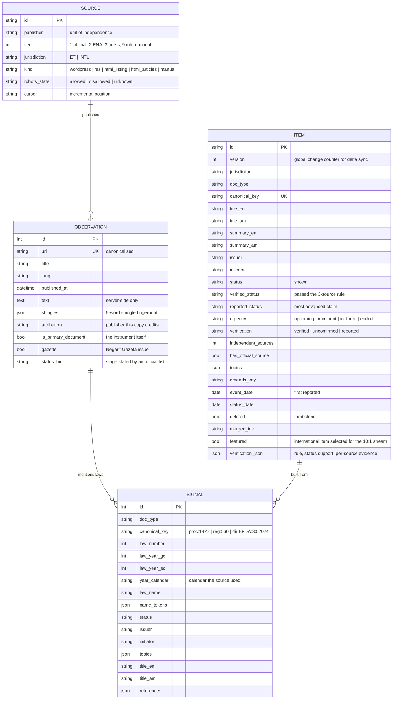

# Data model

## Server (SQLAlchemy, `backend/lexet/models.py`)

Three layers keep evidence separate from conclusions:



Also: `fetch_cache` (ETag / Last-Modified per URL) and `meta` (the version counter).

### Codes

All codes, with English and Amharic labels, live in `shared/taxonomy.json`
(document types, statuses with rank and urgency, urgencies, issuing bodies with
detection patterns, topics with keywords). The backend loads it; the app bundles
the same file as an asset.

| Status | Rank | Urgency |
|---|---|---|
| `policy_signal` | 0 | upcoming |
| `draft` | 1 | upcoming |
| `tabled` (before parliament) | 2 | upcoming |
| `approved` (awaiting gazette) | 3 | imminent — "about to be released" |
| `in_force` | 4 | in_force — "now in force" |
| `amended` | 5 | in_force |
| `repealed` | 6 | ended |

## Feed payload (`feed/snapshot-….json`, `feed/seg-….json`)

Both file kinds are `{"next_since": <version>, "has_more": false, "items": [ … ]}`; the
layout and the index are described in ARCHITECTURE.md › Sync protocol. A real item
from the demo data (two of its six sources shown):

```json
{
  "id": "6dba1b124b674157a4b03b29f5c7955b",
  "version": 18,
  "jurisdiction": "ET",
  "doc_type": "proclamation",
  "law_id": "Proclamation No. 1431/2026",
  "law_number": 1431,
  "law_year_gc": 2026,
  "law_year_ec": 2019,
  "title_en": "Digital Commerce Proclamation",
  "title_am": "የዲጂታል ንግድ አዋጅ",
  "summary_en": "Digital Commerce Proclamation (Proclamation No. 1431/2026), a proclamation, is in force. Initiated by the Ministry of Trade and Regional Integration. Corroborated by 4 independent sources. Official text begins: “WHEREAS it is necessary to provide a legal framework for electronic commerce that protects consumers”",
  "summary_am": "የዲጂታል ንግድ አዋጅ (አዋጅ ቁጥር 1431/2019) · ሁኔታ፦ በሥራ ላይ ያለ · አውጪ፦ የሕዝብ ተወካዮች ምክር ቤት · በ4 ገለልተኛ ምንጮች የተረጋገጠ።",
  "issuer": "HPR",
  "initiator": "MOTRI",
  "status": "in_force",
  "verified_status": "in_force",
  "reported_status": "in_force",
  "urgency": "in_force",
  "verification": "verified",
  "source_count": 4,
  "has_official_source": true,
  "topics": ["digital", "customs", "finance"],
  "amends": null,
  "references": [],
  "event_date": "2026-08-03",
  "status_date": "2026-10-14",
  "first_seen_at": "2026-10-15T14:15:10Z",
  "updated_at": "2026-10-15T14:15:35Z",
  "verified_at": "2026-10-15T14:15:10Z",
  "sources": [
    {"publisher": "FANA", "name": "Fana Media Corporation", "tier": 3,
     "url": "https://demo.lexet.invalid/fana/1", "title": "Council approves draft digital commerce proclamation (DEMO)",
     "lang": "en", "published_at": "2026-08-03T11:00:00Z", "counted": false, "reason": "syndicated from ENA",
     "primary_document": false, "gazette": false, "excerpt": "Addis Ababa, August 3, 2026 (ENA) - The Council of Ministers…"},
    {"publisher": "HPR", "name": "House of Peoples' Representatives", "tier": 1,
     "url": "https://demo.lexet.invalid/hopr/1431.pdf", "title": "Digital Commerce Proclamation No. 1431/2026 …",
     "lang": "en", "published_at": "2026-10-14T00:00:00Z", "counted": true, "reason": "independent",
     "primary_document": true, "gazette": true, "excerpt": "FEDERAL NEGARIT GAZETTE. Proclamation No. 1431/2026. … WHEREAS …"}
  ]
}
```

Excerpts are limited to 280 characters for news sources and 20,000 for official
texts. Tombstones: `{"id": "…", "deleted": true, "merged_into": "…", "version": 19}`.

## Device (Room, `android/app/.../data/db/Database.kt`)

| Table | Purpose | Key columns |
|---|---|---|
| `items` | Full local archive (one row per item, as synced) | `id` PK, `ftsDocId` (stable FTS row id), `version`, law fields, titles, summaries, statuses, `verification`, `topics` (`,a,b,` for LIKE filters), `eventDate`/`statusDate` (epoch days), `sourcesJson` |
| `item_fts` | FTS4 index, *simple* tokenizer | `titles`, `summary`, `lawId`, `meta` (issuer/topic/type labels in both languages), `body` (source titles and excerpts); all pre-normalised by `SearchIndex` |
| `user_state` | Read/unread, bookmark, private note | `itemId` PK |
| `tags`, `item_tags` | User tags | unique tag name; (itemId, tagId) |
| `pending_notices` | Queue for hourly/daily digests | item, title, law ID, change kind, stage phrase |
| `reports` | Generated PDFs | period key (`month-et-2026-10-11`), file path, entry count |

DataStore holds settings (notification filters, digest mode, language and date
display, theme, report calendar, sync interval, Wi-Fi-only, push on/off, server
URL) and sync state (cursor, last success/attempt/error).

User data is keyed by item ID, never by the FTS row, so re-syncs and server-side
merges keep bookmarks and tags (tombstones move them to the surviving item).
