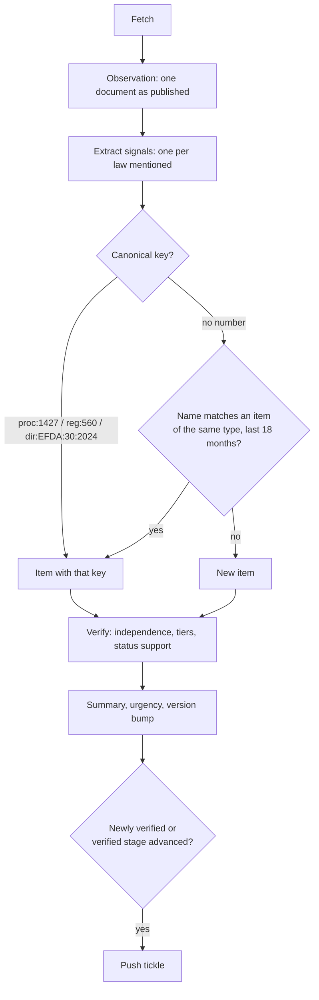

# Ethiopian source verification pipeline

## The rule

> An Ethiopian item is **verified** when at least **three independent publishers**
> report it, and at least one of them is **tier 1** (official government
> publication) or **tier 2** (Ethiopian News Agency). Otherwise it is
> **unconfirmed**: shown in the feed and archive, clearly marked, never notified.

| Tier | Meaning | Configured today |
|---|---|---|
| 1 | Official government publication | Ministry of Justice, House of Peoples' Representatives, Federal Negarit Gazeta (PDFs found on official sites, or assisted entry), EFDA, EIPA |
| 2 | Official news agency | ENA (English and Amharic count as one publisher) |
| 3 | Reputable independent legal / business press | The Reporter, Addis Standard, Capital, Addis Fortune, Fana (state-affiliated; copies of ENA are discounted), Chilot |
| 9 | International / regional | UN News, JURIST, African Union, IGAD — secondary stream, not subject to the rule |

All thresholds are configuration (`backend/lexet/config.py`, environment variables):

| Setting | Default | Effect |
|---|---|---|
| `LEXET_MIN_SOURCES` | 3 | Independent publishers required |
| `LEXET_REQUIRE_OFFICIAL_ANCHOR` | true | At least one tier-1 or tier-2 publisher among them |
| `LEXET_GAZETTE_CONFIRMS_IN_FORCE` | true | See *Status* below |
| `LEXET_OFFICIAL_SELF_PUBLICATION_VERIFIES` | false | If true, an issuing body publishing its own instrument verifies it alone. Off, as specified; many agency directives will therefore stay "unconfirmed · official source" until the press covers them. |

The anchor requirement is an addition to the brief: without it, three newspapers
repeating one rumour would verify it. It can be switched off.

## Pipeline

### 1. Observation

One fetched document — an article, an official listing entry, a gazette PDF — is
stored as evidence: URL (canonicalised, tracking parameters removed), title,
language, publication date, text (kept server-side), a 5-word-shingle fingerprint,
and whether it **credits another publisher** (datelines and credits such as
"(ENA)", "ኢዜአ", "according to ENA", "Source: …"). If the page changes later, the
observation is updated and re-processed.

### 2. Signals — what the document says about each law

- **Law identifiers**, English and Amharic: `Proclamation No. 1427/2026`,
  `Council of Ministers Regulation No. 560/2025`, `Directive No. 30/2024`,
  `አዋጅ ቁጥር 1427/2018`, `መመሪያ ቁጥር 12/2018`, including Ge'ez numerals and old
  spellings (`አዋጅ ቍጥር ፲፬፻፳፯/፳፻፲፰`).
- **Calendar**: the year after the slash is Ethiopian in Amharic texts and Gregorian
  in English ones. Explicit markers (E.C., ዓ.ም) decide first; for proclamations the
  number sequence decides (1427 is a 2026 number, so `1427/2018` must be E.C.);
  otherwise the language decides. Both years are kept.
- **Subject vs reference**: "amending Proclamation No. 1236/2021", "issued under
  Proclamation No. 1183/2020", "በአዋጅ ቁጥር 1183/2012 መሠረት" are citations, not news,
  and do not create items. Citations are recorded as references (and an amendment
  links to the law it amends).
- **Law names** for unnumbered drafts: "Freedom of Information Proclamation",
  "draft proclamation on digital commerce", "የመረጃ ነፃነት አዋጅ". Names are reduced to
  content words (institution names and filler removed) for matching. A report on a
  parliamentary session that passed four laws yields four signals.
- **Status** from the sentences that mention the law, with the subject taken into
  account: the Council of Ministers "approving" a *draft proclamation* means it is
  sent to parliament (**tabled**); parliament approving it means **approved,
  awaiting the gazette**; the Council approving a *regulation* means it is
  enacted. Future or conditional statements ("will enter into force upon
  publication", "once approved by parliament", "ይጠበቃል") are ignored. A gazette PDF,
  or an official list that states the stage, overrides text cues.
- **Issuing body**: proclamations are enacted by the HPR and regulations by the
  Council of Ministers whoever drafted them (the drafting ministry is kept as the
  *initiator*); directives belong to the agency named or the publishing agency.
- **Topics** from an English/Amharic keyword taxonomy (`shared/taxonomy.json`).

### 3. Clustering

1. **Canonical key** — exact, language-independent: `proc:1427` (proclamations and
   regulations are numbered in one running sequence each), `dir:EFDA:30:2024`
   (directive numbers restart per agency).
2. **Name match** against items of the same type first seen in the last 18 months
   (a bill can take that long to reach the gazette): at least two shared content
   words and Jaccard ≥ 0.5 (or containment ≥ 0.85 with three shared words). An
   *amendment* never matches the law it amends.
3. When a numbered report arrives for a law previously seen only by name, the item
   takes the number. A consolidation pass merges duplicate items that later turn out
   to be the same law; the app receives a tombstone and moves bookmarks and tags.

Precision is preferred over recall: merging two different laws would corrupt
verification. For that reason there is **no cross-language matching of
unnumbered drafts yet** — an Amharic-only report and an English-only report of the
same draft stay separate until a number or a bilingual official title links them
(tested in `test_amharic_only_draft_merges_once_a_bilingual_official_title_links_it`).

### 4. Verification

For each item:

1. Order its observations by publication time.
2. An observation is **not counted** if it credits another publisher (*syndicated
   from ENA*), or if its text overlaps an earlier observation from a different
   publisher with shingle Jaccard ≥ 0.5 (*near-duplicate of …*). Official pages are
   never discounted as copies.
3. Each publisher counts once (*same publisher already counted*).
4. Verified if the counted publishers meet the rule above.

The app shows every source with its tier and whether and why it was counted.

### 5. Status

Each counted publisher's claim is the most advanced stage it has reported in any
of its own observations (ENA reporting "tabled" in March and "approved" in June
claims "approved"). A later stage supports the earlier ones.

- **Verified status** — the most advanced stage that at least three counted
  publishers support, with the same anchor requirement.
- **Gazette exception** (`gazette_confirms_in_force`, default on): for an item that
  is already verified, publication in the Federal Negarit Gazeta or the official
  MoJ register settles "in force", because that publication is what puts the law
  into force. This avoids waiting for press coverage of a legal fact that the
  gazette itself establishes.
- **Reported status** — the most advanced stage any counted publisher claims. When
  it is ahead of the verified status, the app says so ("a source reports a later
  stage (approved); it will be shown once corroborated").
- **Amendments**: when an amendment item is in force, the law it amends is marked
  "amended".

Urgency for filters and notifications: *upcoming* = policy initiative, draft or
before parliament; *about to be released* = approved, awaiting the gazette; *now in
force* = in force or amended.

### 6. Summaries

Written from the extracted facts — law ID, type, issuing body, stage, number of
independent sources, any uncorroborated later stage — plus, when an official text
is available, the opening of its preamble. Nothing is copied from news reporting
(that keeps summaries accurate and respects the outlets' copyright). An LLM
summariser can be added behind the same interface, restricted to official text.

### 7. Notifications

The server pushes a tickle when an item becomes verified or its verified stage
advances. The phone repeats the same check against its own copy (it may have
missed intermediate versions) and applies the user's filters.

## Worked example (from the test suite)

| Date | Source | Says | Counted | Item state |
|---|---|---|---|---|
| 2 Mar | ENA (t2) | Cabinet approves draft Digital Commerce Proclamation, forwards it to the House | ✓ | |
| 2 Mar | Fana (t3) | Same text, dateline "(ENA)" | ✗ syndicated from ENA | |
| 4 Mar | The Reporter (t3) | Draft digital commerce bill sent to parliament | ✓ | unconfirmed, tabled (2 sources) |
| 10 Mar | Addis Standard (t3) | House refers draft to standing committee | ✓ | **verified**, tabled → notification |
| 20 Jun | ENA (t2) | House approves the proclamation | (ENA already counted; its claim becomes "approved") | verified tabled; "approved" reported, not yet corroborated |
| 1 Jul | HoPR (t1) | Gazette PDF: Digital Commerce Proclamation No. 1431/2026 (bilingual title) | ✓ | item takes number 1431; **in force** (gazette) → notification |
| 1 Jul | ENA Amharic (t2) | አዋጅ ቁጥር 1431/2018 በነጋሪት ጋዜጣ ታትሞ ወጥቷል | joins by number; same publisher | Amharic title filled in |

## Known limitations

- Unnumbered drafts are not matched across languages (see above). Roadmap: an
  Amharic–English legal glossary and embedding-based matching with curator review.
- Older Amharic gazette PDFs often use legacy non-Unicode fonts and extract as
  noise; titles from listings still work. Roadmap: OCR.
- Status cues are pattern-based; unusual phrasing can be missed (the item then shows
  the stage from other sources). Every rule is covered by tests in
  `backend/tests/test_text.py`; add a test when a new phrasing appears.
- Name extraction needs a recognisable law name; reports that never name the law
  ("the House approved two bills today") produce no signal.
